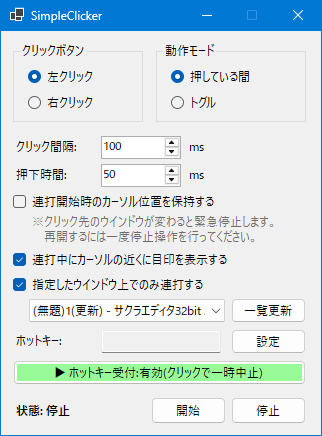
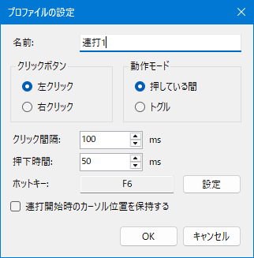

# RenDaClicker

ホットキーでマウス連打(オートクリッカー)を行うツールです。連打設定をプロファイルとして複数登録し、それぞれ別のホットキーに割り当てられます。Windows Forms(.NET 10)製。

　

## 機能

- **プロファイルのリスト管理** — 連打設定をいくつでも登録でき、一覧から「追加」「変更」「削除」で管理します  
同時に動作するのは1つだけです。連打中に別のホットキーを押すとそちらへ切り替わります。
- **プロファイル**
  - **クリックボタン** — 左 / 右クリック
  - **動作モード** — 押している間だけ連打 / 押すたびに開始・停止するトグル
  - **クリック間隔** — 10〜60000ms（既定 100ms）
  - **押下時間** — 1〜60000ms（既定 50ms）
  - **ホットキー** — 「設定」ボタンを押してキーを入力するだけで割り当て。  
  マウスのサイドボタン(XButton1 / XButton2)、Ctrl / Shift / Alt との組み合わせ、修飾キー単体にも対応
  - **カーソル位置の保持**— 連打開始時の位置を記憶し、その位置でクリックし続けます
- **ホットキーの優先順位** — 設定した修飾キーが押されていれば成立します(余分な修飾キーは無視)  
`Tab` と `Shift+Tab` のように複数成立した場合は修飾キーの多いほうが優先、同数なら一覧で上のほうが優先です
- **プロファイルの並び替え** — 「▲」「▼」で順序(=優先順位)を変更できます
- **プロファイルの一時無効化** — 「無効」ボタンで選択したプロファイルだけホットキーに反応しないようにできます(一覧では灰色で表示)。もう一度押すと有効に戻ります
- **連打中の目印表示**— カーソル付近に目印を表示(クリック透過)。左クリックは赤、右クリックは青
- **対象ウインドウの限定**— 連打を特定のウインドウ上（タイトル）に限定し、外れたら緊急停止します  
緊急停止後の再開はホットキーをもう一度押し直してください
- **ホットキー受付の一時中止** — ボタン1つで全プロファイルの判定を止められます
- **設定の自動保存** — 変更のたびに実行ファイルと同じフォルダの `settings.json` へ保存し、次回起動時に復元します  
ウインドウの位置・サイズ、一覧のカラム幅も保存されます

## 使い方

1. `RenDaClicker.exe` を起動します
2. 一覧の「追加」または「変更」でプロファイルを設定します
   - ホットキーは「設定」ボタンを押し、割り当てたいキーまたはマウスのサイドボタンを押します
   - Ctrl / Shift / Alt を押しながら押すと組み合わせに、修飾キーだけを押して離すとその修飾キー単体になります
3. 割り当てたホットキーで連打を開始します
4. 複数のプロファイルが同時に成立しうる場合は「▲」「▼」で優先順位を調整します

ホットキーはグローバルに動作するため、アプリが非アクティブでも使用できます。

## 動作環境

- Windows 10 / 11
- [.NET 10 ランタイム](https://dotnet.microsoft.com/download/dotnet/10.0)(Windows Desktop)

## 注意事項

- 設定ファイル(`settings.json`)は実行ファイルと同じフォルダに保存されます。`Program Files` など書き込み権限のない場所に配置した場合、設定は保存されません

## ライセンス

MIT License
